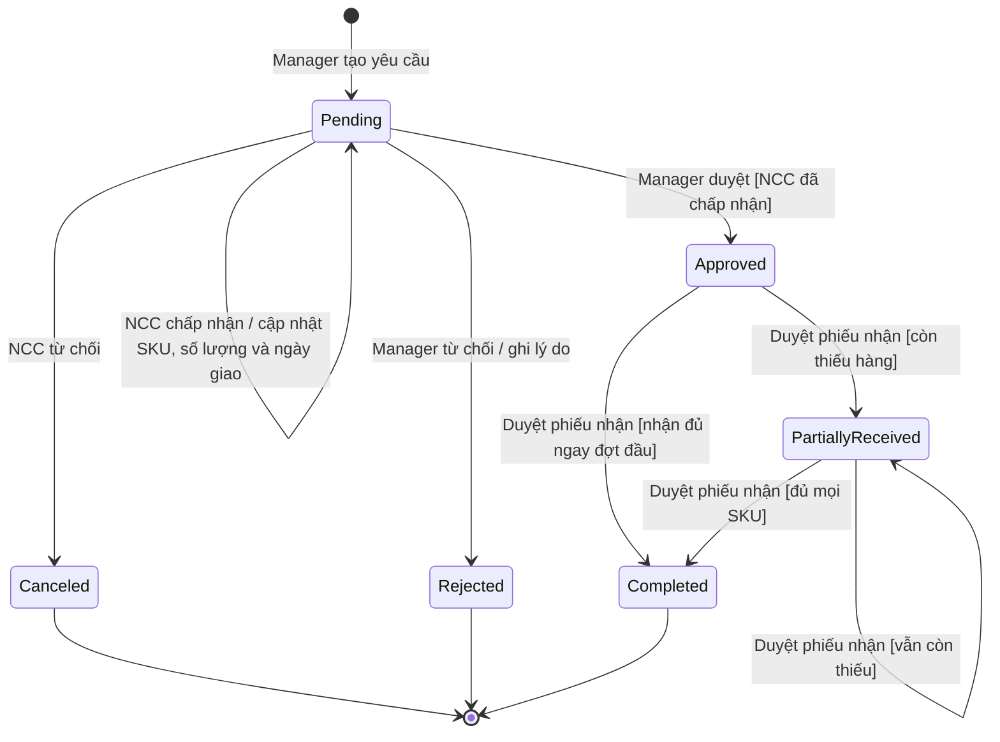
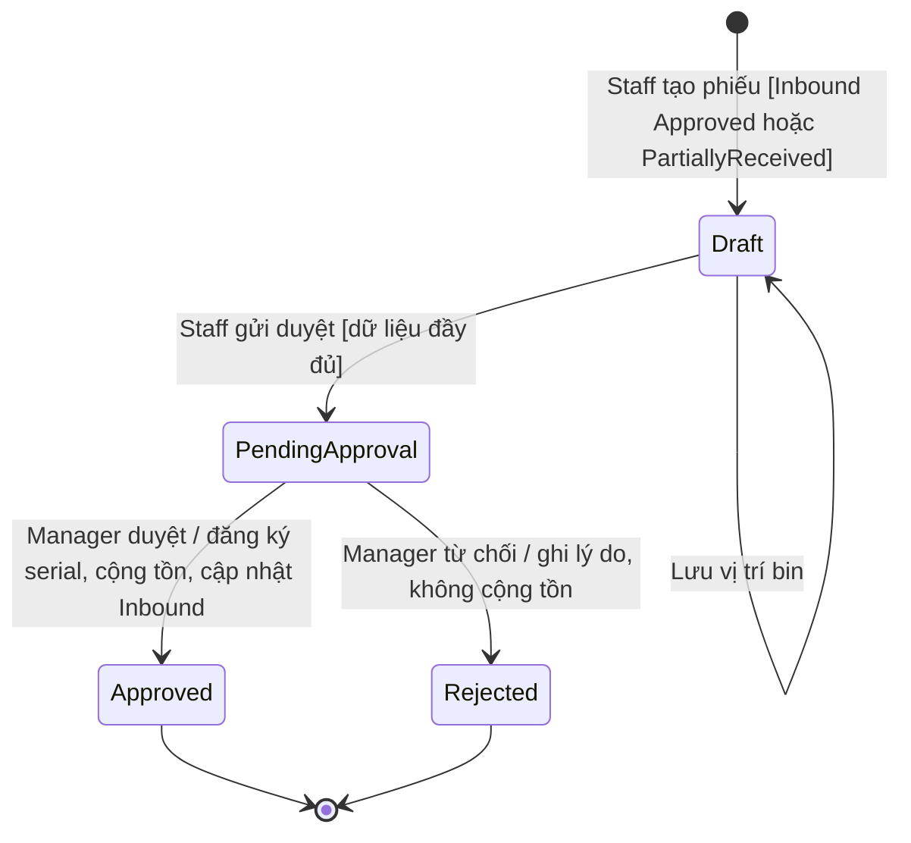

# Hướng dẫn demo Inbound theo SDS

Tài liệu này ánh xạ class diagram, sequence diagram và trạng thái nghiệp vụ sang code hiện tại. Khi có khác biệt giữa State Diagram tổng quát và các sequence chi tiết, nhóm giữ nghiệp vụ của sequence: Staff gửi phiếu, Manager duyệt mới ghi nhận tồn kho. State Diagram được tách theo hai đối tượng bên dưới; không thay đổi file SDS gốc.

## Chuẩn bị

- Mở đúng repo `SWD392_G1` bên trong, branch `Bacsk/goods-receipt`, nơi có `start-dev.cmd` và đầy đủ module nhận hàng.
- Chuẩn bị Manager, Purchasing Manager và Warehouse Staff đang Active, cùng được gán vào kho qua `UserWarehouse`.
- Chuẩn bị supplier Active, sản phẩm Active có SKU hợp lệ và `WeightKg > 0`, bin thuộc đúng kho; sức chứa bin/rack/warehouse phải đủ.
- Script khởi động không tự tạo tài khoản hay dữ liệu demo. Không dùng dữ liệu kiểm thử làm dữ liệu ứng dụng.
- Dùng profile trình duyệt riêng nếu muốn giữ các vai trò đăng nhập đồng thời. Các tab cùng profile dùng chung cookie đăng nhập.

Chạy tại thư mục chứa hướng dẫn README:

```powershell
.\start-dev.cmd
```

Mở `http://127.0.0.1:5173/login`. Khi xong chạy `.\stop-dev.cmd`.

## Hai vòng đời riêng

### Inbound Request — yêu cầu nhập hàng



`Pending` là trạng thái khởi tạo của yêu cầu nhập, không phải `Draft`. Cập nhật cam kết NCC thành Accepted không tự duyệt yêu cầu. `Canceled` là NCC từ chối; `Rejected` là Manager từ chối. Hai kết quả này khác nhau.

### Goods Receipt — phiếu nhận hàng



- Lỗi SKU/serial trong lúc nhập không tự biến phiếu thành Rejected. Phiếu vẫn Draft, số lượng không tăng với scan bị từ chối.
- Bin có thể trống khi tạo/lưu Draft; dòng đã nhận hàng phải có bin khi gửi duyệt.
- PendingApproval khóa việc sửa của Staff. Approved/Rejected là kết quả cuối của phiếu này.
- Chưa có thao tác mở lại hoặc gửi lại cùng phiếu sau Rejected. Muốn nhận lại hàng, tạo phiếu mới nếu yêu cầu nhập vẫn đủ điều kiện.
- Không dùng một trạng thái `Receiving` chung để thay cho cả Inbound Approved và Receipt Draft/PendingApproval. Không đồng nhất Receipt Approved với Inbound Completed: một phiếu đã duyệt vẫn có thể chỉ nhận một phần yêu cầu.

## Kiến trúc triển khai trong phạm vi nhập kho

Đường xử lý chính là **Controller → Service → Repository → EWMSDbContext → SQL Server**. Service điều phối kiểm tra nghiệp vụ và transaction; Repository thực hiện truy vấn/lưu entity. Các repository/service dùng chung scoped DbContext trong một HTTP request để việc duyệt phiếu có thể rollback toàn bộ serial, movement, stock, receipt và tiến độ Inbound.

- Auth dùng `UserRepository`.
- Inbound dùng `IInboundRequestRepository`/`InboundRequestRepository`.
- Goods Receipt dùng `GoodsReceiptRepository`; scan tạm dùng `GoodsReceiptScanRepository`; serial chính thức dùng `SerialNumberRepository`; tồn kho dùng `StockRepository`.
- `GenericRepository<T>` triển khai `IGenericRepository<T>` cho các thao tác dữ liệu dùng chung.
- `GoodsReceiptApprovalService` điều phối duyệt; gọi `StockReceivingService` để tăng tồn và `InboundReceivingService` để cập nhật tiến độ, theo UC56.
- Frontend các trang chi tiết sử dụng `useInboundRequestDetail` và `useGoodsReceiptDetail`, rồi các file `.api.ts` và HTTP client dùng chung. `useGoodsReceiptDetail` quản lý cả scan, lưu, gửi duyệt, quyết định và xử lý rowversion cũ.
- JWT nằm trong cookie HttpOnly; session phía server được thu hồi khi logout/đổi mật khẩu. Mỗi API vẫn kiểm tra role và quyền kho.
- Đợt chỉnh này không thêm migration hoặc đổi schema database.

Architecture tổng thể có thể mô tả mục tiêu toàn hệ thống, nhưng bản demo Inbound này **chưa triển khai đầy đủ CRUD Product/Supplier/Warehouse và SMTP Email Service**. Entity/lookup tương ứng đã có để dùng trong nhập kho. Outbound/Transfer/Inventory cũng không thuộc các API/màn hình đã triển khai trong bản này.

## Ánh xạ class và sequence sang code

Tên C# dùng PascalCase và hậu tố Async; tên khác diagram được ánh xạ bên dưới. Getter trong diagram được thể hiện bằng property C#; không cần thêm getter trùng lặp chỉ để có cùng tên.

| Thành phần trên sơ đồ | Code thực tế | Trách nhiệm khi trình bày |
|---|---|---|
| AuthController → AuthService → UserRepository | `Controllers/AuthController.cs`, `Services/AuthService.cs`, `Repositories/UserRepository.cs` | Tìm tài khoản, kiểm tra mật khẩu/trạng thái, tạo token và quản lý session |
| User.verifyPassword / setPasswordHash | `Entities/User.cs`: `VerifyPassword`, `SetPasswordHash` | Kiểm tra hash bằng PasswordHasher; chỉ lưu hash mới |
| TokenService.generateToken | `Services/TokenService.cs`: `GenerateToken` | JWT chứa user/role/permission và session ID |
| InboundController / InboundService | `InboundRequestController`, `InboundRequestService` | Tạo/xem/cam kết NCC/quyết định yêu cầu |
| InboundRepository.saveWithItems | `InboundRequestRepository.CreateAsync` | Lưu header và items trong transaction |
| saveCommitment / recordSupplierCommitment | `SaveCommitmentAsync` → `InboundRequest.RecordSupplierCommitment` | Accepted giữ Pending; Rejected chuyển Canceled |
| updateConfirmedDetails | `InboundRequestItem.UpdateConfirmedDetails` | Cập nhật variant và số lượng NCC xác nhận |
| approveRequest / recordApproval | `ReviewInboundRequestAsync` với Decision Approved → `SaveApprovalAsync` → `RecordApproval` | Yêu cầu Pending và NCC đã chấp nhận trước khi duyệt |
| rejectRequest / recordRejection | `ReviewInboundRequestAsync` với Decision Rejected → `SaveRejectionAsync` → `RecordRejection` | Lý do từ chối bắt buộc |
| GoodsReceiptService | `Services/GoodsReceiptService.cs` | Tạo Draft, đọc/sửa phiếu, kiểm tra dữ liệu và gửi PendingApproval |
| GoodsReceipt.confirm / updateStatus | `GoodsReceipt.Confirm`, `UpdateStatus` | Confirm là gửi duyệt; Manager mới quyết định Approved/Rejected |
| GoodsReceiptItem.updateQuantity | `GoodsReceiptItem.UpdateQuantity` | Số lượng nhận lấy từ số scan đã lưu, không tin số lượng tùy ý của client |
| SerialNumberService / scan Repository | `SerialNumberService.AddAsync` → `GoodsReceiptScanRepository` | Kiểm tra format, SKU, trùng và lưu scan tạm |
| registerSerial / updateSerialStatus | `SerialNumberRepository.RegisterWithMovement` → `SerialNumber.UpdateStatus` | Chỉ đăng ký serial IN_STOCK khi Manager duyệt |
| StockUpdateService | `StockReceivingService`, `InboundReceivingService` | Tách tăng tồn và tính tiến độ nhưng cùng transaction duyệt |
| Stock.increaseOnHand | `Stock.IncreaseOnHand` qua `StockReceivingService.ApplyApprovedReceiptAsync` | Tăng OnHandQty, giữ ReservedQty |
| GoodsReceiptApprovalService | `ApproveAsync` / `RejectAsync` | Kiểm tra quyền/kho/trạng thái/version; commit hoặc rollback toàn bộ |

## Ánh xạ endpoint để mở Swagger hoặc theo dõi Network

| Sequence | API | Vai trò/thao tác |
|---|---|---|
| SD07 Login | `POST /api/auth/login` | Đăng nhập; frontend lấy CSRF token trước request ghi |
| SD08 Logout | `POST /api/auth/logout` | Thu hồi session, xóa cookie |
| SD09 Change Password | `POST /api/auth/change-password` | Mật khẩu mới 6–128 ký tự, khác cũ, xác nhận khớp; thành công phải đăng nhập lại |
| SD01 List Inbound | `GET /api/inbound-requests` | Danh sách theo quyền kho/role |
| SD02 Detail Inbound | `GET /api/inbound-requests/{id}` | Chi tiết hoặc 404/403 |
| SD03 Create Inbound | `POST /api/inbound-requests` | Manager chọn kho, Staff, SKU và số lượng |
| SD04 Supplier Commitment | `PUT /api/inbound-requests/{id}/supplier-commitment` | Purchasing cập nhật Accepted/Rejected |
| SD05/SD06 Inbound Decision | `PUT /api/inbound-requests/{id}/review` | Decision Approved/Rejected; từ chối phải có lý do |
| List/Detail Receipt | `GET /api/goods-receipts`, `GET /api/goods-receipts/{id}` | Staff/Manager xem phiếu trong kho được phép |
| UC17 Create Receipt | `POST /api/goods-receipts` | Staff tạo Draft từ yêu cầu đã duyệt và còn hàng |
| UC18 Save Draft | `PUT /api/goods-receipts/{id}` | Lưu bin với ExpectedVersion |
| UC18 Submit | `POST /api/goods-receipts/{id}/submit` | Gửi duyệt với ExpectedVersion; UI lưu bin trước rồi gửi version vừa nhận |
| UC50 Enter Serial | `POST /api/goods-receipts/{id}/items/{itemId}/serials` | Thêm một scan; sai format/SKU/trùng thì trả lỗi |
| UC56 Approve Receipt | `POST /api/goods-receipts/{id}/approve` | Manager duyệt và ghi nhận tồn kho |
| UC56 Reject Receipt | `POST /api/goods-receipts/{id}/reject` | Manager từ chối kèm lý do; không tăng tồn |
| Track Progress | `GET /api/inbound-requests/{id}/receiving-progress` | Chỉ tính số lượng từ phiếu Approved |

## Kịch bản demo nhận hàng hai đợt

1. **Manager — tạo:** đăng nhập, tạo yêu cầu một SKU số lượng **3**, chọn kho và Staff hợp lệ. Kết quả Inbound Pending. Mở lại chi tiết để trình bày SD01/SD02/SD03.
2. **Purchasing — cam kết:** chọn supplier Active, Accepted, ngày giao hôm nay hoặc sau đó, xác nhận SKU/số lượng 3. Kết quả cam kết Accepted nhưng Inbound vẫn Pending.
3. **Manager — duyệt yêu cầu:** xem chi tiết mới nhất, thử mở xác nhận rồi quay lại; mở lại và duyệt. Kết quả Inbound Approved.
4. **Staff — tạo phiếu đợt 1:** chọn yêu cầu vừa duyệt, tạo phiếu. Kết quả Receipt Draft, số lượng 0, bin có thể chưa chọn.
5. **Staff — kiểm tra serial:** thử mã có khoảng trắng để thấy lỗi format; phiếu vẫn Draft. Scan hai mã chưa tồn tại, ví dụ `DEMO-261107-A001` và `DEMO-261107-A002` (đổi phần mã đợt demo nếu đã dùng). Scan lại một mã để thấy duplicate không tăng số lượng.
6. **Staff — xếp bin/gửi:** chọn bin, lưu nháp; số lượng là 2. Gửi Manager duyệt. Receipt PendingApproval; tồn kho và serial chính thức chưa được ghi nhận.
7. **Manager — duyệt phiếu đợt 1:** kiểm tra thông tin, duyệt. Receipt Approved; Stock tăng 2, hai serial IN_STOCK kèm movement. Inbound PartiallyReceived, remaining 1.
8. **Staff — nhận đợt 2:** tạo phiếu mới cho cùng Inbound, scan mã thứ ba, chọn bin và gửi duyệt.
9. **Manager — duyệt đợt 2:** Receipt mới Approved; tổng nhận đủ 3, Inbound Completed, remaining 0. Hệ thống không cho tạo thêm phiếu nhận cho yêu cầu này.

Khi đổi người dùng trong cùng profile, logout trước rồi login role tiếp theo. Mỗi người nên tải chi tiết mới nhất trước quyết định; revision/rowversion cũ sẽ bị từ chối thay vì ghi đè.

## Kịch bản nhánh thay thế

- **Supplier từ chối:** dùng yêu cầu khác đang Pending, Purchasing chọn Rejected; Inbound Canceled, không thể duyệt hoặc nhận hàng.
- **Manager từ chối yêu cầu:** dùng yêu cầu Pending khác, chọn Reject, nhập lý do; Inbound Rejected. Không có đường gửi lại cùng yêu cầu.
- **Manager từ chối phiếu:** tạo/scan/gửi phiếu khác, Manager nhập lý do từ chối; Receipt Rejected, không cộng Stock hoặc đăng ký serial chính thức. Inbound giữ tiến độ từ những phiếu Approved trước đó.
- **Thiếu bin hoặc không có scan:** thử gửi Draft chưa đủ dữ liệu; hệ thống báo lỗi và giữ Draft.
- **Sai SKU qua API:** form scan gửi SKU từ sản phẩm đang chọn; muốn demo payload SKU sai cần dùng Swagger/API. Không tuyên bố giao diện có ô quét SKU độc lập.
- **Tài khoản inactive:** đăng nhập đúng mật khẩu của tài khoản đã bị vô hiệu hóa để thấy thông báo riêng. Nhập sai mật khẩu vẫn báo sai thông tin đăng nhập.
- **Đổi mật khẩu:** thử mật khẩu mới dưới 6 ký tự hoặc xác nhận không khớp; thử sai mật khẩu hiện tại; sau đó đổi bằng mật khẩu hợp lệ ít nhất 6 ký tự, khác mật khẩu cũ. Các session bị thu hồi, đăng nhập lại bằng mật khẩu mới.

## Kiểm tra trước buổi demo

```powershell
dotnet test EWMS/EWMS.sln --no-restore
cd frontend
npm.cmd run lint
npm.cmd run build
```

Test SQL dùng database `EWMS_GoodsReceiptTests_<guid>` riêng, không dùng database ứng dụng. Kết quả kiểm chứng cuối cùng được ghi trong báo cáo phiên sửa; hướng dẫn không cố định số lượng test. Rehearsal giao diện bằng dữ liệu demo thật vẫn cần thực hiện trước buổi trình bày.

## Xử lý tình huống thường gặp

- Không thấy kho/Staff: kiểm tra trạng thái Active và UserWarehouse của từng tài khoản.
- Không thấy yêu cầu để nhận: kiểm tra Approved/PartiallyReceived, kho được phép và remaining > 0.
- Báo dữ liệu cũ: tải lại chi tiết rồi kiểm tra lại trước khi gửi quyết định. Không gửi lại version cũ liên tục.
- Báo trùng serial: chọn mã chưa tồn tại. Thêm serial bị lỗi không làm tăng số lượng.
- Báo thiếu sức chứa: đổi bin phù hợp và kiểm tra cả tải trọng rack/warehouse.
- Không sửa được phiếu: chỉ người tạo được sửa Draft; PendingApproval/Approved/Rejected bị khóa theo nghiệp vụ.

## Tài liệu liên quan

- [README](../README.md): chạy/dừng ứng dụng, cấu hình kiểm thử.
- [Nhật ký đồng bộ SDS](journals/261107-sds-alignment.md): quyết định và phạm vi thay đổi.
- SDS Report 2 của nhóm: các sequence Authentication, Inbound và Goods Receipt; State Diagram trong hướng dẫn này là bản tách hai vòng đời để thống nhất với sequence đã chọn.
